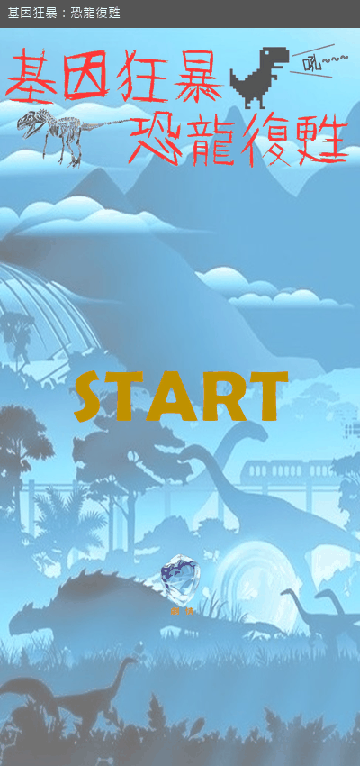
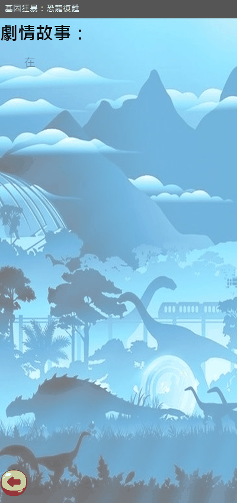
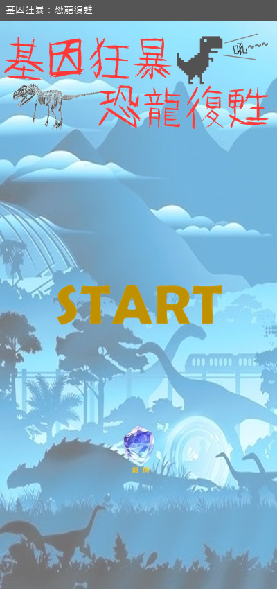
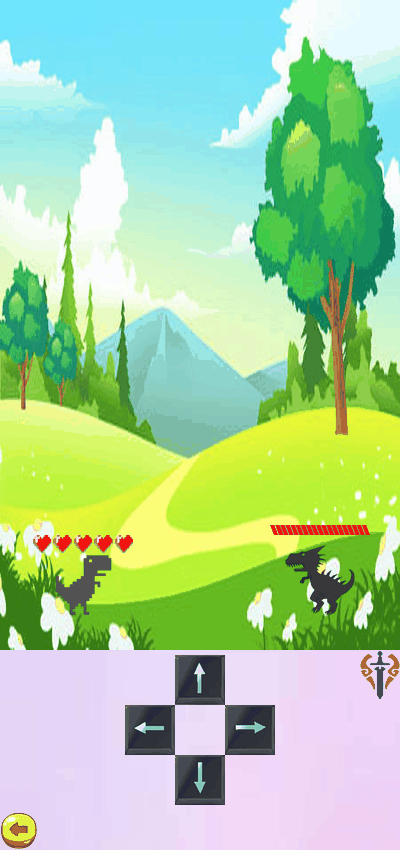
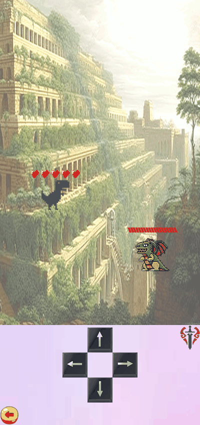
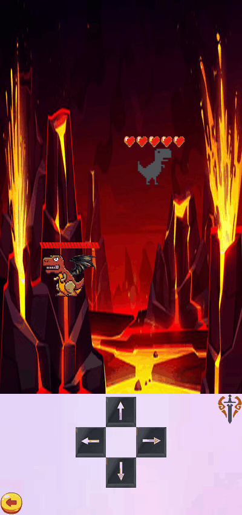
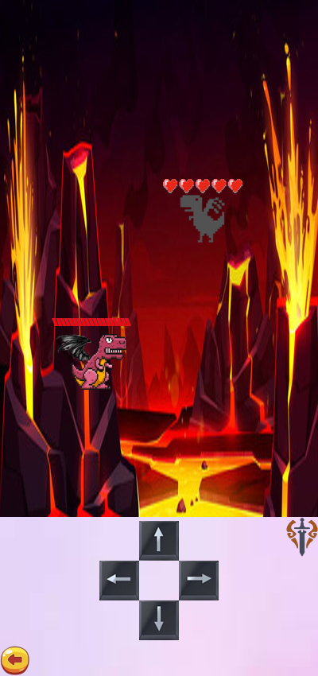

# 基因狂暴 恐龍復甦

使用 App Inventor 製作的 Android 遊戲。玩家扮演倖存的小恐龍，在戰鬥中蒐集 DNA，逐步推進關卡與解鎖造型。

## 原作動畫與互動

[開啟互動還原展示](https://tokizakisora.github.io/genetic_rampage/demo/index.html)

下載demo資料夾後，以瀏覽器開啟 `index.html` 即可操作（亦可點擊上方連結）。

| 開始按鈕浮動 | 故事逐字顯示 | 選關視窗開關 |
| --- | --- | --- |
|  |  |  |

動畫和互動依 BKY 事件轉寫，沿用原圖片與座標。開始按鈕按下時改用 `blstart.png`，放開後恢復並進入主線。故事每 100 毫秒增加一字。選關視窗以原始 `form1.png` 等素材組合，關閉鍵按下時改用 `blackno.png`。

### 商店的原始操作順序

- 初始 DNA 為 0，直接購買獨狼會顯示「持有DNA數量不足!」。
- DNA 足夠時購買扣除 100，提示「購買成功!」，按鈕改成「使用」。
- 再次點選已持有造型，才會切換選中角色，並顯示橘色「使用中」。
- 木星及太陽的造型，依原始關卡進度與持有狀態開放。

專案原有隱藏 GM 入口也已轉寫。在主畫面畫布的 x 256–320、y 30–94 區域點五次，背景改成原始 `test.jpg`，並採用原 GM 初始資料，DNA 為 1000、進度為 3。這可用來檢視原有購買及切換分支。座標以 400 像素寬的畫布計，另加上方標題列 30 像素。

## 原始遊戲介面

| 主畫面 | 關卡選擇 | 商店 |
| --- | --- | --- |
|  |  |  |

三張圖片依 AIA 原始素材及 SCM 的圖片、尺寸、座標與表格位置組合，呈現配置與指定初始化狀態。以 400 像素寬作為還原尺寸，實機上的排版、字型與執行時位置可能不同。

主畫面包含標題、開始按鈕與劇情水晶。關卡選擇以星球作為入口，右側設有首頁及商店按鈕。商店採三欄表格呈現角色、價格及關卡開放條件。

## 戰鬥動畫

| 地球 | 木星 | 太陽 |
| --- | --- | --- |
|  |  |  |

每段動畫長 5.6 秒，依序示範移動、點擊射擊與按住技能。輸入順序及開場位置依作品介紹安排，動作與效果由原始 BKY 積木執行。每張 GIF 每 40 毫秒取樣一幀。

- **移動**　方向鍵按下啟用對應計時器，每 10 毫秒改變 3 像素，放開後停用。角色依方向與飛行狀態切換原始圖片。
- **射擊**　點擊畫布後選擇子彈並指定方向，子彈 Speed 為 10、Interval 為 20 毫秒。玩家子彈使用原本的紅色 Ball，頭目子彈為藍色。
- **技能**　按住技能鍵啟用 100 毫秒計時器，自動朝向頭目並持續呼叫原射擊程序。放開後停用該計時器。
- **命中回饋**　命中時執行原始碰撞事件，更新血量及對應的血量圖片。
- **原有旋轉邏輯**　執行啟用中的「使1旋轉」程序，保留第一顆子彈的狀態與方向變化。原本停用的另外兩個旋轉程序維持停用。

互動展示中的戰鬥也已更新，可直接操作方向鍵、點擊射擊與按住技能。支援同時按住方向鍵及技能鍵。

## 戰鬥與操作

戰鬥畫面使用 AIA 素材，以 BKY 初始化與首次狀態更新作為基礎，再依各關安排不同角色位置。地球呈現地面對峙，木星呈現升空，太陽呈現換邊與高低差。使用原始飛行與朝向圖片配合角色位置，血量圖片維持原程式的跟隨規則。這些位置是經授權安排的作品介紹情境。

| 地球 | 木星 | 太陽 |
| --- | --- | --- |
|  |  |  |
| 草地背景與獨狼頭目 | 遺跡背景與史塔克頭目 | 火焰背景與飛行頭目 |

初始玩家採原預設小恐龍，HP 為 5，頭目 HP 為 19。展示圖的角色位置依關卡安排，血量圖片維持在角色上方 20 像素。

### 原始控制區配置

以 400 × 850 的內容區還原，戰鬥畫布高 650，操作區高 160，返回列高 40。原程式隱藏戰鬥標題列。

操作面板保留上下左右四個方向鍵、右側技能鍵與下方返回按鈕。還原時計算 BKY 設定座標後，也套用 App Inventor 的邊界修正，將圖像精靈移回各自的小畫布範圍內，讓按鈕完整顯示。這項處理依循 Sprite 的 registerChange、hitEdgeAbstract 與 MoveIntoBounds 呼叫流程。[App Inventor 原始碼](https://github.com/mit-cml/appinventor-sources/blob/master/appinventor/components/src/com/google/appinventor/components/runtime/Sprite.java)

Android 原生排版與實機位置仍待 APK 核對。

可在 [battle-source.json](demo/battle-source.json) 查看 SCM、三關計算後的元件屬性及全域狀態，presentation 欄位另記錄介紹圖的角色配置。

- 方向鍵控制小恐龍上下左右移動。
- 點擊戰鬥區射擊，攻擊頭目。
- 技能鍵用來強化攻擊手段。
- 暫停鍵可暫停戰鬥。
- 戰鬥結算顯示勝負及獲得的 DNA。

## 關卡與商店

從地球開始挑戰，通過後開放木星，再通過木星開放太陽。DNA 可用來購買造型，部分造型需要通過指定關卡。商店程式會依持有角色與關卡進度更新圖片及按鈕，並標示目前使用中的造型。

## 技術實作

| 功能 | 實作方式 |
| --- | --- |
| 戰鬥角色與子彈 | Canvas 與 ImageSprite |
| 持續移動、出招與動畫 | Clock 計時器 |
| 命中及血量變化 | 碰撞事件與狀態更新 |
| 主線、戰鬥及商店 | 多畫面與事件處理 |

## 作品說明文件

[閱讀圖文作品說明 PDF](docs/基因狂暴%20恐龍復甦_作品介紹.pdf)

## 圖片來源

主畫面、選關及商店圖片依原始專案靜態配置還原。戰鬥介面由 AIA 素材與 SCM、BKY 的計算狀態組合。互動展示依 BKY 的指定事件重新實作。戰鬥部分由匯出的 BKY 積木執行初始化、移動、射擊、技能、頭目計時及碰撞事件，角色開場位置採介紹用配置。Android 原生提示使用瀏覽器提示框呈現，外觀依瀏覽器而定。

此資料夾包含 README、介面 PNG 與 PDF，可作為 GitHub 的作品介紹內容。尚未指定授權條款。

## 還原依據與檢查範圍

| 原始檔案及事件 | 還原內容 |
| --- | --- |
| Screen1 Initialize、動畫 Timer | 開始按鈕置中、Speed 1、25 ms 計數改變 Heading 270／90 |
| Screen1 開始 TouchDown／TouchUp | 按下換圖、放開恢復並進入主線 |
| Screen1 劇情水晶、逐字出現故事內容 Timer | 切換故事配置、每 100 ms 增加一字 |
| story_line Initialize、星球 TouchUp、name 程序 | 隱藏或開啟原始關卡視窗、限制其他星球操作 |
| story_line 關閉、進入事件 | 原始按下圖片、關閉視窗或進入戰鬥 |
| shop Initialize、造型一按鈕 TouchDown | DNA 條件、購買扣款、持有狀態及第二次點選切換 |

展示以 400 × 820 的表單內容區為基準，另加 30 像素標題列。原生配置、字型與 Notifier 外觀採瀏覽器呈現。ImageSprite 的 Interval 在 SCM 中未明寫，展示採 100 ms 預設值，因此浮動的精確相位仍需實機核對。

已檢查初始化、關卡視窗、鎖關、DNA 不足、原 GM 資料、購買後尚未切換、再次點選切換及逐字計時的狀態分支。已檢查三關移動速度、按鍵放開停動、子彈速度與間隔、第一顆子彈的原有位置行為，以及技能按住連射與放開停止。瀏覽器實際操作與 APK 對照仍待驗證。GIF 重播會重新開始展示，原程式則依返回與切換事件繼續處理。

## 戰鬥動畫的還原方式

`demo/battle-program.js` 保存由 AIA 匯出的原始戰鬥積木結構及區塊 ID。`battle-engine.js` 執行其變數、分支、程序、元件屬性與事件。`battle-animation-trace.json` 記錄各段的輸入順序、執行區塊及結束狀態，方便與 BKY 對照。

子彈半徑採 Ball 元件預設的 5 像素，未指定的圖像精靈 Interval 採 100 毫秒。畫布超界時會把精靈移回邊界內。[App Inventor Ball 原始碼](https://github.com/mit-cml/appinventor-sources/blob/master/appinventor/components/src/com/google/appinventor/components/runtime/Ball.java)、[Sprite 原始碼](https://github.com/mit-cml/appinventor-sources/blob/master/appinventor/components/src/com/google/appinventor/components/runtime/Sprite.java)

還原保留原積木的特殊寫法。例如第一顆玩家子彈的發射分支省略 MoveTo，會沿用當時位置，再依原有旋轉、移動及回收程序處理。

原檔的「暫停狀態」宣告標記為停用，但仍被其他事件引用。展示採用該宣告原本的值 0 初始化此變數。這項相容處理與 Android 的精確事件排程仍需 APK 對照。

引擎以 2 毫秒步進處理計時與球體、角色矩形的碰撞，頭目的亂數以固定種子重播。GIF 使用同一份積木及引擎輸出狀態，再以原始圖片合成。操作順序、亂數種子及開場位置屬於展示設定，動作、傷害與換圖取自原程式。尚未完成瀏覽器及 APK 的並排實機驗證。
