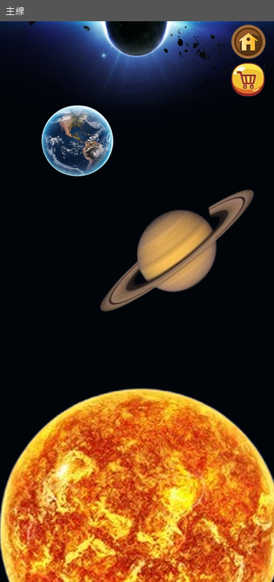
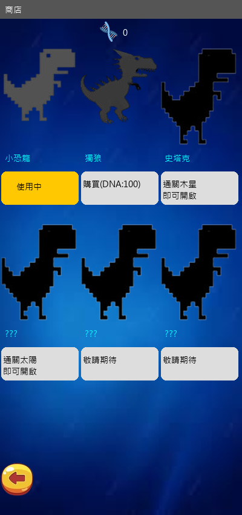
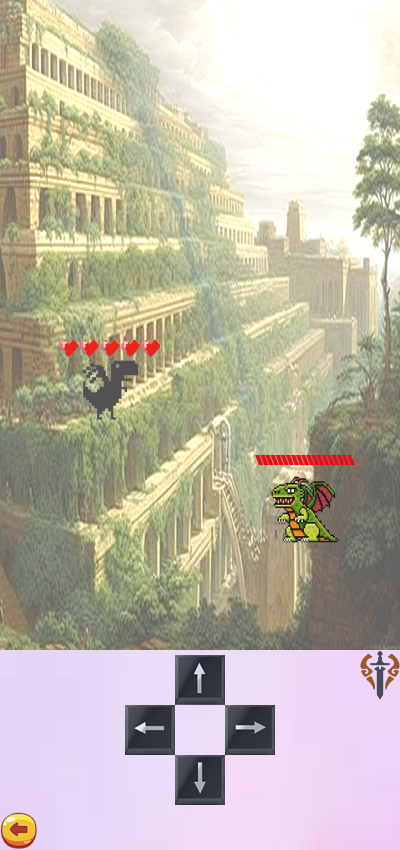

# 基因狂暴 恐龍復甦

使用 App Inventor 製作的 Android 遊戲。玩家扮演倖存的小恐龍，在戰鬥中蒐集 DNA，逐步推進關卡與解鎖造型。

## 原作動畫與互動

[開啟互動還原展示](https://tokizakisora.github.io/genetic_rampage/demo/index.html)

下載demo資料夾後，以瀏覽器開啟 `index.html` 即可操作（亦可點擊上方連結）。

| 開始按鈕浮動 | 故事逐字顯示 | 選關視窗開關 |
| --- | --- | --- |
|  |  |  |

（隱藏 GM 入口：主畫面右上方的小恐龍連續點擊五次，背景轉換後即採用 GM 初始資料，DNA 為 1000、進度為 3。這可用來檢視原有購買及切換分支。

## 原始遊戲介面

| 主畫面 | 關卡選擇 | 商店 |
| --- | --- | --- |
|  |  |  |

### 商店的原始操作順序

- 初始 DNA 為 0，直接購買獨狼會顯示「持有DNA數量不足!」。
- DNA 足夠時購買扣除 100，提示「購買成功!」，按鈕改成「使用」。
- 再次點選已持有造型，才會切換選中角色，並顯示橘色「使用中」。
- 木星及太陽的造型，依原始關卡進度與持有狀態開放。

主畫面包含標題、開始按鈕與劇情水晶。關卡選擇以星球作為入口，右側設有首頁及商店按鈕。商店採三欄表格呈現角色、價格及關卡開放條件。

## 戰鬥動畫

| 地球 | 木星 | 太陽 |
| --- | --- | --- |
|  |  |  |

- **移動**　方向鍵按下啟用對應計時器，每 10 毫秒改變 3 像素，放開後停用。角色依方向與飛行狀態切換原始圖片。
- **射擊**　點擊畫布後選擇子彈並指定方向，子彈 Speed 為 10、Interval 為 20 毫秒。玩家子彈使用原本的紅色 Ball，頭目子彈為藍色。
- **技能**　按住技能鍵啟用 100 毫秒計時器，自動朝向頭目並持續呼叫原射擊程序。放開後停用該計時器。
- **命中回饋**　命中時執行原始碰撞事件，更新血量及對應的血量圖片。
- **原有旋轉邏輯**　執行啟用中的「使1旋轉」程序，保留第一顆子彈的狀態與方向變化。原本停用的另外兩個旋轉程序維持停用。

互動展示中的戰鬥也已更新，可直接操作方向鍵、點擊射擊與按住技能。支援同時按住方向鍵及技能鍵。

## 戰鬥與操作

戰鬥畫面使用 AIA 素材，以 BKY 初始化與首次狀態更新作為基礎，再依各關安排不同角色位置。地球呈現地面對峙，木星呈現升空，太陽呈現換邊與高低差。使用原始飛行與朝向圖片配合角色位置，血量圖片維持原程式的跟隨規則。這些位置是經授權安排的作品介紹情境。

| 地球 | 木星 | 太陽 |
| --- | --- | --- |
|  |  |  |
| 草地背景與獨狼頭目 | 遺跡背景與史塔克頭目 | 火焰背景與飛行頭目 |

初始玩家採原預設小恐龍，HP 為 5，頭目 HP 為 19。展示圖的角色位置依關卡安排，血量圖片維持在角色上方 20 像素。
- 方向鍵控制小恐龍上下左右移動。
- 點擊戰鬥區射擊，攻擊頭目。
- 技能鍵用來強化攻擊手段。
- 暫停鍵可暫停戰鬥。
- 戰鬥結算顯示勝負及獲得的 DNA。

## 關卡與商店

從地球開始挑戰，通過後開放木星，再通過木星開放太陽。DNA 可用來購買造型，部分造型需要通過指定關卡。商店程式會依持有角色與關卡進度更新圖片及按鈕，並標示目前使用中的造型。

## 技術實作

| 功能 | 實作方式 |
| --- | --- |
| 戰鬥角色與子彈 | Canvas 與 ImageSprite |
| 持續移動、出招與動畫 | Clock 計時器 |
| 命中及血量變化 | 碰撞事件與狀態更新 |
| 主線、戰鬥及商店 | 多畫面與事件處理 |

## 作品說明文件

[閱讀圖文作品說明 PDF](docs/基因狂暴%20恐龍復甦_作品介紹.pdf)
